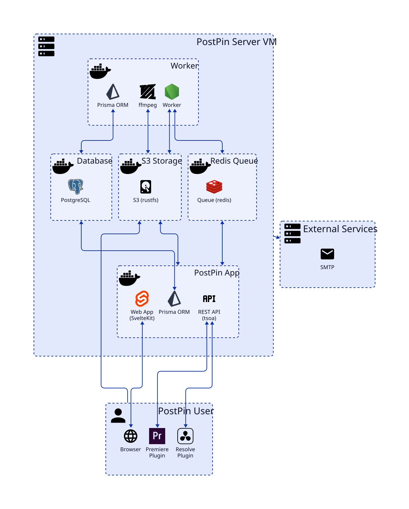

# PostPin

## Getting Started

See [Self-Hosting PostPin](docs/self-hosting.md) for instructions on how to install and run PostPin on your own server.
[Web Upload](docs/web-upload.md) describes uploading videos from the browser instead of a plugin.

## System Architecture



## Development

### Requirements

- Node.js
- pnpm
- protobuf (`brew install protobuf` on macOS)

### Setup

```bash
pnpm -r run setup
```

### Development Commands

- `pnpm dev` - Starts the development server for the frontend and backend.

### Changesets and releases

Every pull request that changes a package needs a changeset, otherwise the Changeset check fails.
Tests, READMEs and changelogs don't count.

```bash
pnpm changeset              # pick the packages and the bump, write the entry
pnpm changeset add --empty  # for changes users don't notice (refactors, CI, dependency bumps)
```

Pick the packages whose users notice the change:

- `@postpin-io/postpin`: the web app (review, sharing, organizations, the API)
- `@postpin-io/worker`: media processing (transcoding, thumbnails, cut detection)
- `@postpin-io/desktop`, `@postpin-io/resolve-plugin`, `@postpin-io/premiere-plugin`: the plugins
- `@postpin-io/deploy`: self-hosting (env vars, compose.yml, install script)

Write one entry as `**Title**: What changed, from the reader's side.` The CHANGELOG.md files, the
GitHub release notes and the in-app What's New show it as written; What's New leaves out
`@postpin-io/deploy`. Major, minor or patch decide the version bump and the section the entry goes
in.

All packages share one version, which is also the release tag. To release: `pnpm changeset
version`, commit, then tag `v<version>`. The Release workflow builds the release notes from the
changelogs (`scripts/release-notes.mjs`) and stops before publishing anything when a stable
version has none.
