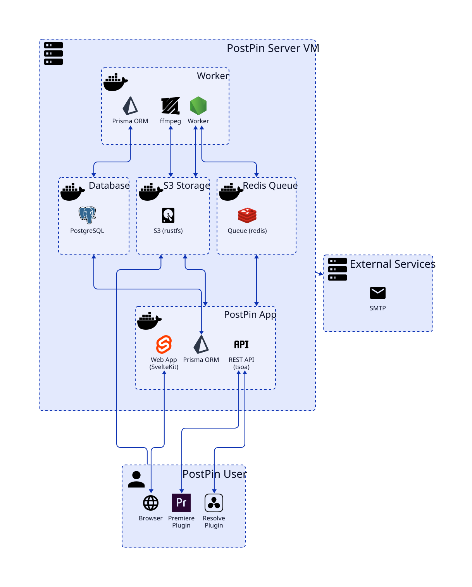

# PostPin

## Getting Started

See [Self-Hosting PostPin](docs/self-hosting.md) for instructions on how to install and run PostPin on your own server.

## System Architecture



## Development

### Requirements

- Node.js
- pnpm
- protobuf (`brew install protobuf` on macOS)

### Setup

```bash
pnpm -r run setup
```

### Development Commands

- `pnpm dev` - Starts the development server for the frontend and backend.
